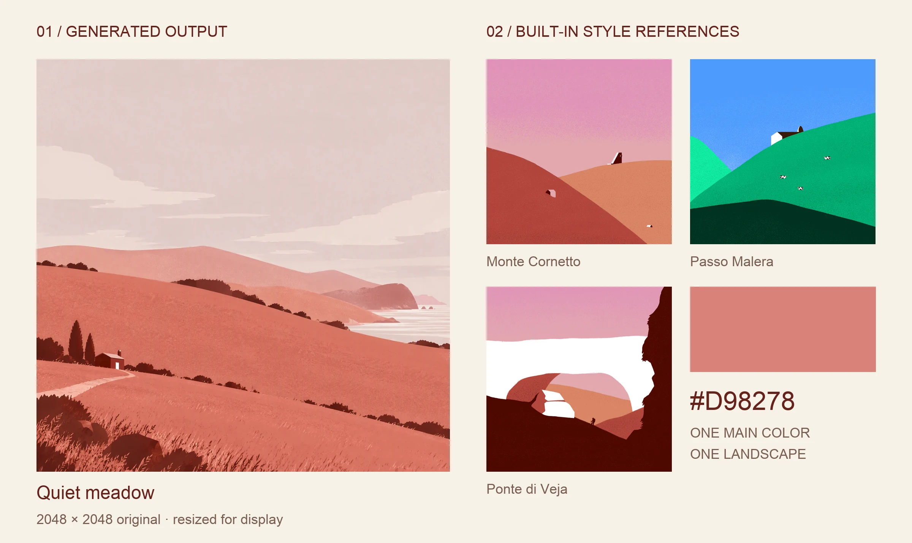

<p align="center">
  
</p>

# yoho-retro-poster

给 Agent 一个主色，生成一张 **2048×2048、方形无字的复古风景插画**。

<p align="center">
  
</p>

**实际生成 · 静静的草坡**：主色 `#D98278`，macOS 上通过第三方 `gpt-image-2` 直接返回 2048×2048 PNG。展示板中的另外三张是内置风格样张，用来说明视觉方向。

一个 `#RRGGBB` 主色即可开始，最多再给两个指定色；地点、季节、情绪和禁用元素均可选。Agent 根据整组配色联想环境与氛围，自行设计主体、天气、视角和构图，默认只发起一次图像请求。

## 从一个颜色开始

### 1. 安装 Skill

在支持 Skill 的 Agent 中安装：

```sh
npx skills add Yohoia/yoho-retro-poster --skill yoho-retro-poster
```

也可以直接告诉 Agent：

> 请帮我安装这个 Skill：https://github.com/Yohoia/yoho-retro-poster

仓库根目录就是 Skill 源码。手动安装时，将仓库克隆到宿主的 Skill 目录，并将目录命名为 `yoho-retro-poster`。

### 2. 首次配置

需要 **Python 3.10+、Node.js 22.18+、本机浏览器和系统凭据服务**。在已安装的 Skill 目录运行：

```sh
cd scripts/credential-ui
npm ci --ignore-scripts
cd ../..
python3 scripts/provider_route.py
```

默认优先检查 OpenAI 官方接口。需要配置官方 Key 时运行：

```sh
node scripts/credential-setup.ts official
```

若选路结果为 `setup_required`，按它给出的命令配置第三方 Key：

```sh
node scripts/credential-setup.ts thirdparty
```

打开命令返回的本机链接，**由你自己输入并保存密钥**；不要把密钥发给 Agent，也不要写入项目配置或 `.env`。页面只有保存按钮，点击后自动检查连接：失败时显示错误，允许替换后再次保存；成功后等待命令返回 `selected`，Agent 自动重新检查服务并继续原任务，无需再回复“已配置”。未填写或检查未通过时命令持续等待，可在运行命令的终端按 Ctrl+C 取消。宿主需支持保持命令会话并等待完成。

### 3. 说出你的颜色

> 使用 `$yoho-retro-poster`，用 `#D98278` 生成一张风景海报，场景由你根据配色想象。

Agent 会选取参考、规划场景，再交付一张 PNG。视觉方向来自随 Skill 分发的 **8 张内置样张**：大色块、简化造型、清楚的空间层次、宽阔留白与可选的细微纸面颗粒。用户提供参考图时优先使用用户图片，参考的是视觉语言，题材由本次配色与用户要求决定。

同样是蓝色，可以联想到海洋中的鲸鱼、天空中的飞鸟，也可以是冰川与细雪。它们只是说明颜色如何启发想象；每次由 Agent 设计一个连贯、好看的风景，再写入专属提示词，保持统一的简洁画风。

## 你会得到什么

| 项目 | 结果 |
| --- | --- |
| 成品 | 一张 2048×2048 方形 PNG，无标题文字与海报边框 |
| 方案 | 单场景 `plan.json`，记录颜色、构图和参考图 |
| 生成记录 | 同名 JSON，保留 Prompt、模型、服务地址、参考图哈希和请求 ID（若接口提供） |
| 重复运行 | 完整结果会跳过；方案或参考图改变时要求新建任务目录 |
| 并发保护 | 同一输出任务只允许一个进程生成；先检查输出目录再调用接口 |

成品默认保存在方案旁的 `output/poster-<id>.png`。已有结果不会覆盖，参考图目录不会修改。

[查看视觉规范](references/style.md) · [查看方案格式](references/plan-format.md) · [了解本机凭据组件](scripts/credential-ui/README.md)

## 数据、费用与使用边界

颜色、场景说明和选用的参考图会发送给选中的图像接口，生成可能产生服务费用。凭据值由本机包装器提供给业务进程，不进入 Agent 对话、生成记录或命令参数。

当前已在 **macOS + 第三方 `gpt-image-2`** 上验证真实 2048×2048 生成并完成目视检查；官方接口及其他系统尚未完成真实生成验证。Windows Credential Manager 与 Linux Secret Service 已有适配，尚未实机验证。无可用安全后端时停止，不退回明文存储。

<details>
<summary>服务选择与模型设置</summary>

官方接口为 `https://api.openai.com/v1`；只有官方凭据缺失、鉴权失败（HTTP 401/403），或模型列表明确不含所选模型时，才检查 `https://image.aicodeme.xyz/v1`。两边默认模型均为 `gpt-image-2`，凭据独立使用；若接口无响应，流程暂停，不自动切换服务。

在 Skill 目录查看或修改模型：

```sh
python3 scripts/poster.py config show
python3 scripts/poster.py config set --final-model gpt-image-2
python3 scripts/poster.py config set --thirdparty-final-model gpt-image-2
```

修改前请确认模型支持本流程的图像编辑与目标尺寸。普通设置存于当前用户的平台配置目录，可用 `COLOR_SCENE_POSTER_CONFIG` 指定其他设置文件；其中不应保存 API Key。

Skill 更名后保留旧版配置目录、环境变量和系统凭据引用，已有模型设置与 API Key 无需重新配置。

</details>

<details>
<summary>密钥保存、连接检查与排查</summary>

| 平台 | 系统凭据服务 | 实机验证 |
| --- | --- | --- |
| macOS | 当前用户的 Keychain | 已验证 |
| Windows | Credential Manager | 尚未验证 |
| Linux | Secret Service | 尚未验证 |

官方与第三方凭据互不共用。页面保存的系统凭据优先，缺失时才复用对应的 `OPENAI_API_KEY` 或 `AICODEME_API_KEY`；系统库不可用但已有运行时密钥时也可使用环境来源。包装器只向业务进程提供所选服务的凭据，页面替换的新值不会被旧环境密钥覆盖。

凭据页在保存后自动查询当前服务的模型列表，不生图，也不能保证图像端点或所选尺寸可用。401、403、模型缺失或网络错误会显示在页面中，任务保持等待；输入新值并点击“替换并保存”即可重新验证。连接检查通过后才继续。等待入口不会在固定时限后退出，关闭浏览器也不会取消命令；需要停止时取消运行中的命令。保存中断后先检查状态。

第三方返回 HTTP 401 时，请使用该服务个人中心创建的**开发者 SK**，重新打开第三方凭据页替换；网页登录凭据不能用于图像 API。若返回尺寸与请求不符，先核对开发者密钥绑定的请求分组。

部分 macOS 独立 Python 安装缺少默认 CA 证书包；程序会在系统证书包可用时使用 `/etc/ssl/cert.pem`，并继续校验 TLS 证书。

本地输入页减少密钥误贴、误存的风险，但不能对同一用户下任意可执行程序提供强隔离。完整行为见[凭据组件说明](scripts/credential-ui/README.md)。

</details>

<details>
<summary>手动生成、输出与放大导出</summary>

按[方案格式](references/plan-format.md)创建 `version: 2` 的单场景 `plan.json`，在 Skill 目录运行：

```sh
python3 scripts/poster.py validate /path/to/plan.json
node scripts/credential-ui/src/profile.ts run official -- python3 scripts/poster.py generate /path/to/plan.json --provider official
```

选路结果是 `thirdparty` 时，将命令中的两处 `official` 均替换为 `thirdparty`。Agent 默认选取 1–3 张内置样张，并将实际路径写入 `references`；生成时会上传到所选服务。用户提供的参考图优先使用，手动方案也可将 `references` 留空，使用文字视觉规范。

程序检查 API 返回 PNG 的真实尺寸、数据块校验和、像素流解压与扫描行结构。已有图片和记录均完整且与当前方案一致时跳过；结果不完整、损坏或方案改变时停止，先人工检查。输出目录中的隐藏 `.poster-<id>.lock` 文件用于进程互斥，进程退出后锁自动释放，文件可以保留。修改场景时使用新任务目录，保留旧图。

需要 3508×3508 文件时，安装 Pillow 并在生成命令后加 `--upscale-3508`：

```sh
python3 -m pip install Pillow
```

这是从 2048×2048 插值放大的版本，文件名标为 `upscaled`，不会增加真实细节。印刷色彩模式、出血和纸张适配不属于本 Skill。

旧版 `preview`、`final --scene` 和计费 `self-test` 入口已移除。旧多场景方案请按[方案格式](references/plan-format.md)迁移至新任务目录；已有成品和旧测试记录保留。

</details>

<details>
<summary>开发验证</summary>

在 Skill 目录运行 Python 回归测试，覆盖单次请求、固定尺寸和重复运行保护：

```sh
python3 -m unittest discover -s tests -v
```

验证凭据组件：

```sh
cd scripts/credential-ui
npm run check
npm run build
npm test
npm run test:native
```

`test:native` 当前在 macOS 验证。正式生图需要你自己的有效凭据和可用额度，生成效果取决于服务端模型行为。

</details>
